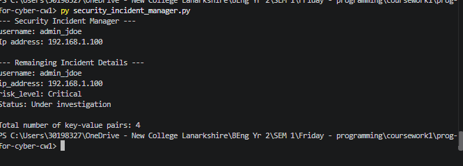
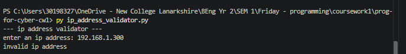

# prog-for-cyber-cw1
Name: Haseeb Rasool
Campus: New College Lanarkshire
banner ID: B01887873

# program overview
i made a python script that is designed to validate ipv4 addresses with error handling and automatic chekcs. i used input validation and a continous main loop that handles user prompts

## code features
i used ip.strip() to strip leading/trailing whitespace from the input string. made sure that dot characters existed in the entered string.used ip.count() to count that there was exactly 3 dots in the string. i split the dots into a list using parts=ip.split(".") and confirmed its results in four distinct parts. used exception in a while true loop with a try and except block to catch unexpected errors.

# how to run 
open terminal in repo folder and make sure you are on the ip-address-validator branch then type in gitbash terminal: py ip_address_validator.py

## image

